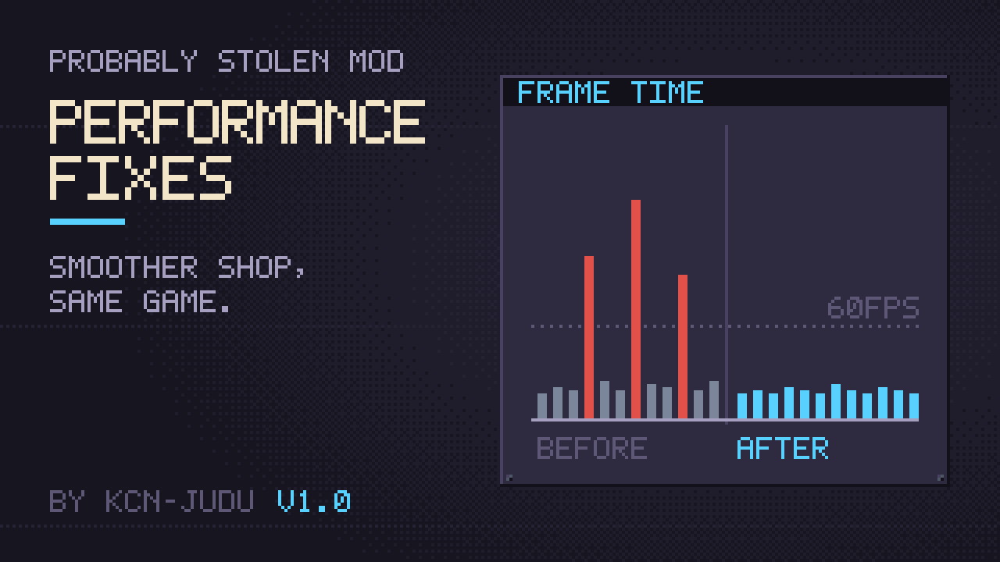

# Performance Fixes



A mod for *Probably Stolen*. Removes stutters from the base game when you work with large, packed storage: opening and closing full windows, loading a large store, and trading with nested containers. Every fix keeps the game's behaviour and can be switched off on its own.

**Windows of other mods:** with Hide closed windows instantly on, a closed container window stays switched on with its canvas off. A mod that checks `activeSelf`, opens its window with `SetActive(true)` or refreshes it in `OnEnable` may find that its window does not open again. If a window from another mod misbehaves, turn that option off in the mod's settings. See [Disclaimer: windows of other mods](doc/manual/windows.md#disclaimer-windows-of-other-mods).

**Documentation:** <https://kcn-judu.github.io/ProbablyStolen-Mods/en/performance-fixes/> ([简体中文](https://kcn-judu.github.io/ProbablyStolen-Mods/zh-cn/performance-fixes/))

Part of the [Probably Stolen mods collection](https://github.com/KCN-judu/ProbablyStolen-Mods).

## Install

Subscribe on the [Steam Workshop](https://steamcommunity.com/sharedfiles/filedetails/?id=3832481577), or copy the folder from a [release](https://github.com/KCN-judu/ProbablyStolen-PerformanceFixes/releases) into the game's `Mods` folder. Then enable the mod in the game's Mods menu and restart the game.

## Build

```bash
./build.sh            # out/performance_fixes
./build.sh --install  # also copies it to the game's Mods folder
```

See [Building](doc/manual/building.md) for the requirements and the `GAME` and `CSC` variables.

## Repository layout

| Path | Contents |
| --- | --- |
| `src/` | The mod's source |
| `tools/` | The generators of `src/Targets.g.cs` and `src/Callees.g.cs`, the method lists of the profiler |
| `Localization/` | The options' text, one file per game language |
| `build.sh` | The build script |
| `tests/` | Headless tests of the decisions in `src/*.Pure.cs` (`tests/run.sh`) |
| `doc/manual/` | Documentation, in English (the source of every translation) |
| `doc/locale/` | Translations of the documentation, as gettext catalogs |
| `manifest.xml`, `preview.png` | What the game reads, next to the DLL |
| `WORKSHOP.txt` | The Steam Workshop description, in BBCode |
| `CHANGELOG.md` | Changes by version |

## License

[Apache License 2.0](LICENSE).
