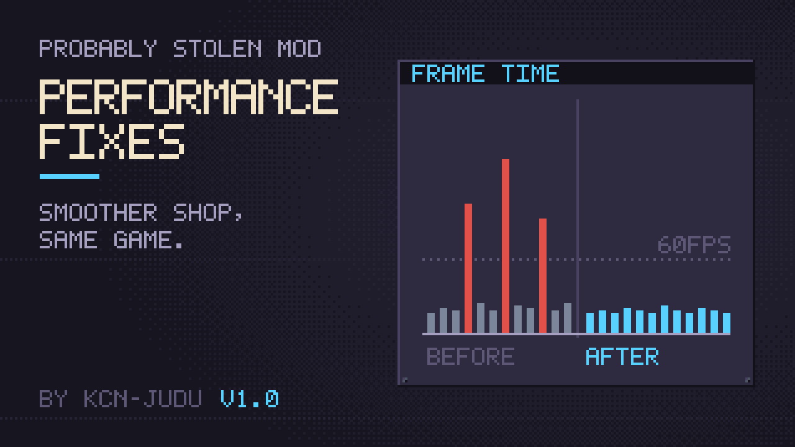

# Performance Fixes

Smoother shop, same game. This mod removes stutters from the base game when you work with large, packed storage. Every fix keeps the game's behaviour and only removes wasted work.

## Options

Every fix has its own switch in the mod's options: open the Mods menu, select Performance Fixes and click the gear icon. All of them are on by default except the profiler.

| Section | Option | Default | What it does |
| --- | --- | --- | --- |
| Windows | Separate canvas per window | on | Each container window is drawn on its own canvas, so a change in one window no longer redraws every open window. |
| Windows | Keep closed windows in place | on | A closed window stays in the floating-window layer, so reopening it does not move its contents between canvases. |
| Windows | Hide closed windows instantly | on | A closed container window stops being drawn instead of having everything inside switched off, so reopening a full window is nearly instant. Needs the two options above. |
| Windows | Open preset windows one by one | on | The storage-preset hotkey opens or closes its windows over a few frames, the first at once, so animations keep running. |
| Inventories | Batch inventory layouts | on | Each inventory is re-laid out once per frame instead of once per item change. |
| Customers | Fast buyer check | on | The customer's buying check on containers runs once per item instead of re-checking every level. |
| Diagnostics | Log long frames | on | Writes frames over 100 ms to `Player.log` with the window opened just before. |
| Diagnostics | Profile long frames | off | Breaks frames over 100 ms down by method. Slows the game slightly. |

If anything looks wrong, turn off the option for that area and report what you saw.

## The fixes

- [Windows](windows.md): separate canvases, windows kept in place, instant hiding and staggered presets.
- [Inventories](inventories.md): one layout per inventory per frame.
- [Customers](customers.md): the buying check in one pass.
- [Diagnostics](diagnostics.md): the long-frame log and the profiler that found all of the above.
