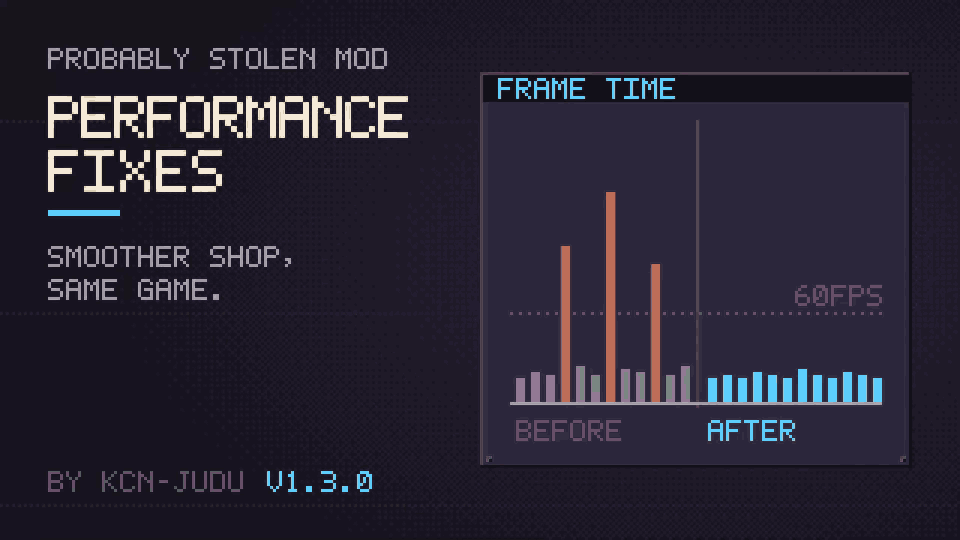

# Performance Fixes

This mod removes stutters from the base game when you work with large, packed storage. Every fix keeps the game's behaviour and removes only work the game repeats for nothing.

Loading a save and opening full containers, with this mod off and on, recorded in the game on a real tested large store (the loading part plays at double speed):

## Options

Every fix has its own switch in the mod's options: open the Mods menu, select Performance Fixes and click the gear icon. All of them are on by default except the profiler.

| Section | Option | Default | What it does |
| --- | --- | --- | --- |
| Windows | Separate canvas per window | on | Each container window is drawn on its own canvas, so a change in one window no longer redraws every open window. |
| Windows | Keep closed windows in place | on | A closed window stays in the floating-window layer, so reopening it does not move its contents between canvases. |
| Windows | Hide closed windows instantly | on | A closed container window stops being drawn instead of having everything inside switched off, so reopening a full window is nearly instant. Needs the two options above. |
| Windows | Open preset windows one by one | on | The storage-preset hotkey opens or closes its windows over a few frames, the first at once, so animations keep running. |
| Inventories | Batch inventory layouts | on | Each inventory is re-laid out once per frame instead of once per item change. |
| Inventories | Check items once while loading | on | While a save loads, each item's look is worked out once per inventory instead of dozens of times. |
| Inventories | Build UI in place | on | The parts of items, windows, inventories and machine panels are created where they belong instead of being created elsewhere and moved. |
| Inventories | Lighter shape checks | on | Working out an item's shape and state skips the search under an item that has nothing under it. |
| Inventories | Fast selection highlight | on | The highlight under selected items is updated in place instead of being redrawn every frame, so holding or dragging a large selection no longer stutters. |
| Loading | Lighter store preload | on | The early look at a save's store reads only the upgrades it checks instead of the whole store. |
| Loading | Skip unchanged settings | on | Entering the store no longer rewrites the settings file for settings that already hold the same value. |
| Loading | Free the store when leaving | on | Leaving the store lets go of everything that still pointed at it, so the next load does not start with the old store in memory. |
| Customers | Fast buyer check | on | The customer's buying check on containers runs once per item instead of re-checking every level. |
| Diagnostics | Log long frames | on | Writes frames over 100 ms to `Player.log` with the window opened just before. |
| Diagnostics | Profile long frames | off | Breaks frames over 100 ms down by method. Slows the game slightly. |

If anything looks wrong, turn off the option for that area and report what you saw.

> [!NOTE]
> A window made by another mod can fail to open again while Hide closed windows instantly is on. If one does, turn that option off. See [Disclaimer: windows of other mods](windows.md#disclaimer-windows-of-other-mods).

## The fixes

- [Windows](windows.md): separate canvases, windows kept in place, instant hiding and staggered presets.
- [Inventories](inventories.md): one layout per inventory per frame, the selection highlight updated in place, each item checked once while a save loads, UI built in place and lighter shape checks.
- [Loading](loading.md): the whole load with and without this mod, the lighter store preload, unchanged settings left unwritten, and the store freed when you leave it.
- [Customers](customers.md): the buying check in one pass.
- [Cost analysis](cost.md): how much work each fix removes, in terms of the sizes involved.
- [Diagnostics](diagnostics.md): the long-frame log, the load timeline and the profiler that found all of the above.
